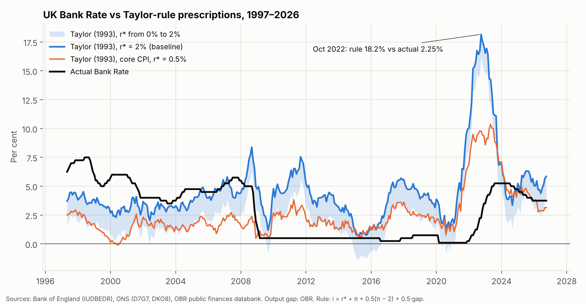
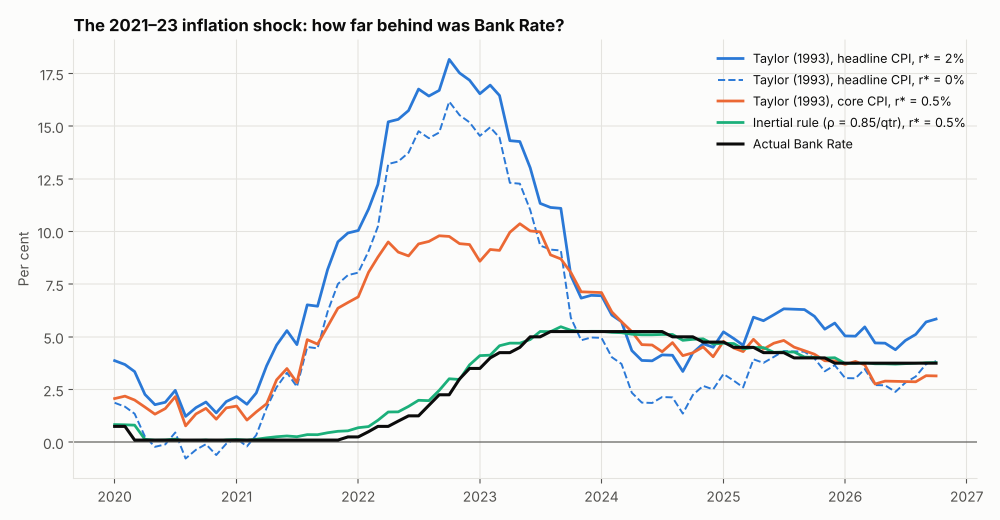
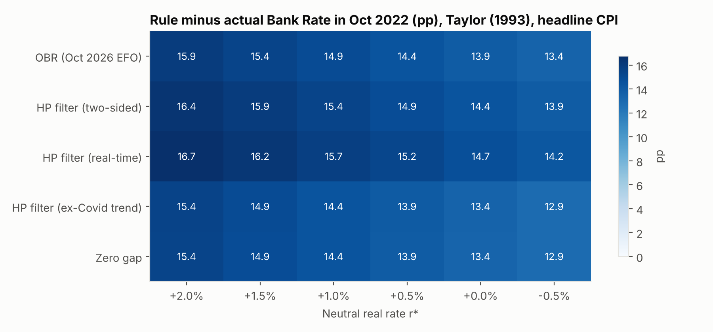
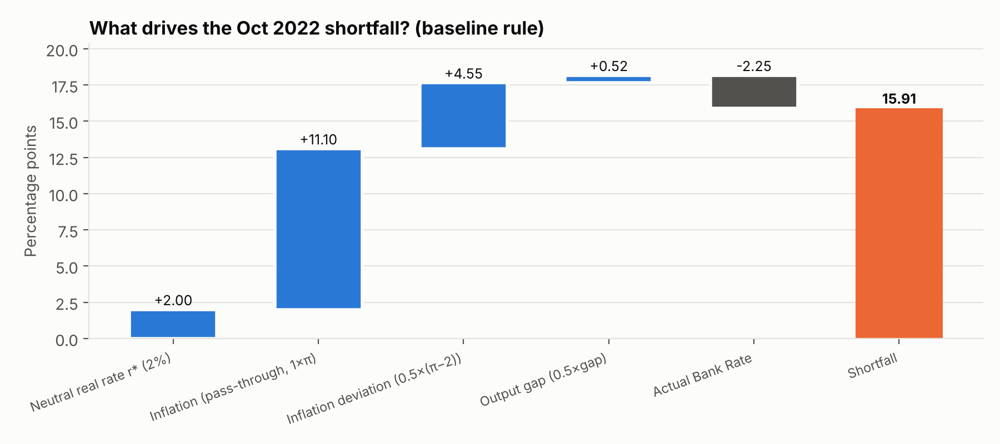

# Taylor Rule vs Bank Rate: Was the Bank of England Behind the Curve?

Independent project (Python). A Taylor-rule benchmark for UK Bank Rate from Bank of England
independence (May 1997) to October 2026, built from Bank of England, ONS and OBR data, with
sensitivity analysis on the neutral real rate (r*), the output-gap estimate, the inflation measure
and the rule's coefficients.

## Headline finding

Under the original Taylor (1993) rule (r* = 2%, 2% CPI target, OBR output gap, headline CPI), the
rule implied a Bank Rate of **18.2% in October 2022**, when actual Bank Rate was **2.25%**, a
shortfall of **15.9 percentage points**.

**The neutral-rate assumption explains little of that gap.** Cutting r* from 2% to 0% closes only
2pp (13%). Across r* from −0.5% to 2% and five output-gap measures, the shortfall stays between 12.9pp and
16.7pp. The gap comes from the rule's response to 11% inflation (π plus 0.5(π − 2), together
15.7pp), not from r* or the output gap (+0.5pp). Using core CPI (excluding energy and food) and
r* = 0.5% shrinks the shortfall to 7.5pp, and the smallest shortfall anywhere in the grid is 6.0pp.
So the "behind the curve" verdict holds under every specification. What changes it is how much of
the 2022 energy shock you think policy should have looked through, not the choice of r*.






Full numbers: `results/results.md`, `results/sensitivity_grid.csv`, `results/rule_paths.csv`.

## Data

| Series | Source | Code | Frequency → treatment |
|---|---|---|---|
| Official Bank Rate | Bank of England IADB | IUDBEDR | daily → month-end |
| CPI annual rate | ONS MM23 | D7G7 | monthly |
| Core CPI annual rate (excl. energy, food, alcohol, tobacco) | ONS MM23 | DKO8 | monthly |
| Real GDP (CVM) | ONS QNA | ABMI | quarterly → HP-filter gaps, mid-quarter, interpolated |
| Output gap (% of GDP) | OBR public finances databank, Oct 2026 EFO | "Output gap" | fiscal year → placed at October, linearly interpolated |

The snapshots in `data/raw/` were downloaded on 24 November 2026. `python src/fetch_data.py`
refreshes them from source (if a download fails, the existing snapshot is kept).

## Method

Rule: `i* = r* + π + a_π(π − π*) + a_y·gap`, π* = 2%.

* **Rules:** Taylor (1993) a_π = a_y = 0.5; Taylor (1999) a_y = 1.0; an inertial rule
  `i_t = ρ·i_{t−1} + (1 − ρ)·i*_t` with ρ = 0.85 per quarter, anchored on the actual previous rate.
* **r\*:** 2% (Taylor's original), 1.5, 1.0, 0.5, 0, −0.5%.
* **Output gap:** OBR; two-sided HP filter (λ = 1600) on log real GDP; one-sided "real-time" HP
  (trend re-estimated each quarter using only data to date); HP with the Covid quarters
  (2020Q1–2021Q3) interpolated out of the trend; and zero gap.
* **Inflation:** headline CPI and core CPI.
* The headline month is the month of 2022 where the baseline shortfall was largest.

## Caveats

* Before December 2003 the MPC targeted RPIX at 2.5%. Applying a 2% CPI target to that period
  biases the rule down (CPI ran below RPIX). This is why the 1997–2003 rule sits below Bank Rate.
* The rule uses CPI for month *m* against month-end Bank Rate in *m*. The MPC only sees that print
  about 3–4 weeks later, so the comparison is slightly generous to the rule.
* The OBR gap is a 2026 vintage, so it is revised, not real time. The real-time HP variant
  addresses this partly. HP gaps are distorted around Covid (see `figures/05_output_gap_measures.png`).
* The inertial rule is anchored on last month's actual rate, so by construction it tracks Bank
  Rate closely. It shows the direction the rule pushes, not an independent level.
* The Taylor rule is a descriptive benchmark, not an optimal policy. A rule-implied 18% says that
  a mechanical rule treats a supply shock like a demand shock. It does not show that 18% was right.

## Run it

```bash
pip install -r requirements.txt
python src/fetch_data.py      # optional: refresh data/raw from source
python src/run_analysis.py    # builds data/processed/panel.csv, results/, figures/
```

## Layout

```
src/fetch_data.py     download BoE / ONS / OBR data
src/dataset.py        clean, align to monthly, HP filters, OBR interpolation
src/taylor.py         rule definitions
src/run_analysis.py   rule paths, sensitivity grid, decomposition, charts, results.md
data/raw/             source snapshots (24 Nov 2026)
data/processed/       monthly panel
results/  figures/    outputs
```

## CV bullet (filled in)

* Built a Taylor-rule benchmark for UK Bank Rate (1997–2026) from Bank of England, ONS CPI and
  OBR output-gap data, testing sensitivity to the neutral rate and output-gap estimate
* Found the rule implied 18.2% Bank Rate by October 2022 versus an actual 2.25%, a gap of 15.9pp;
  the neutral-rate assumption explains only ~2pp (13%) of the gap, and even with core CPI and
  r* = 0.5% Bank Rate was still 7.5pp below the rule
